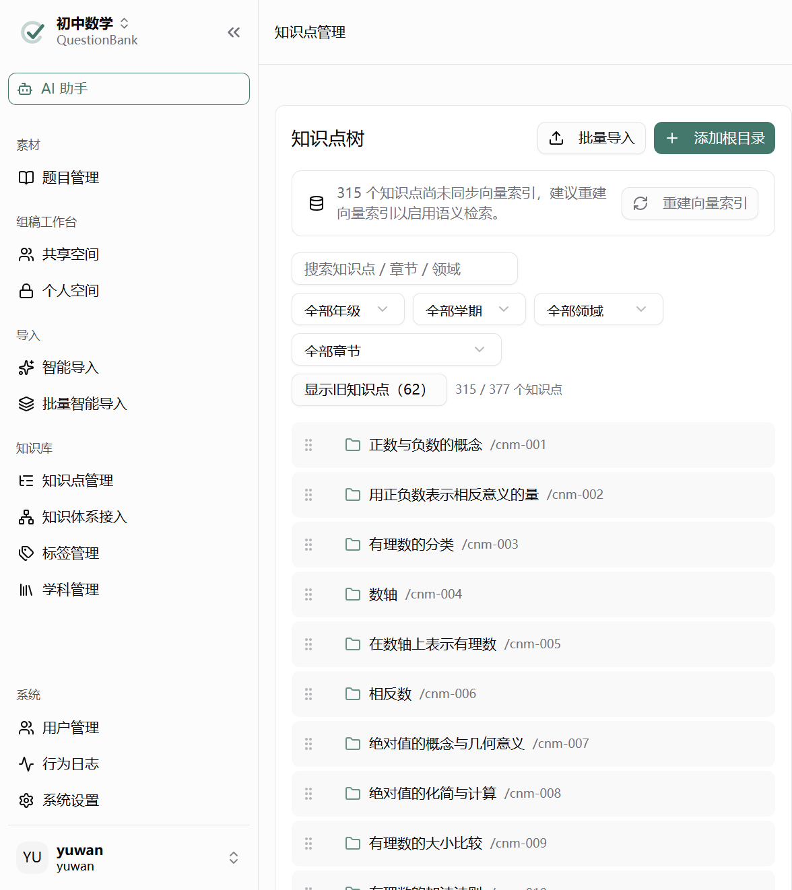
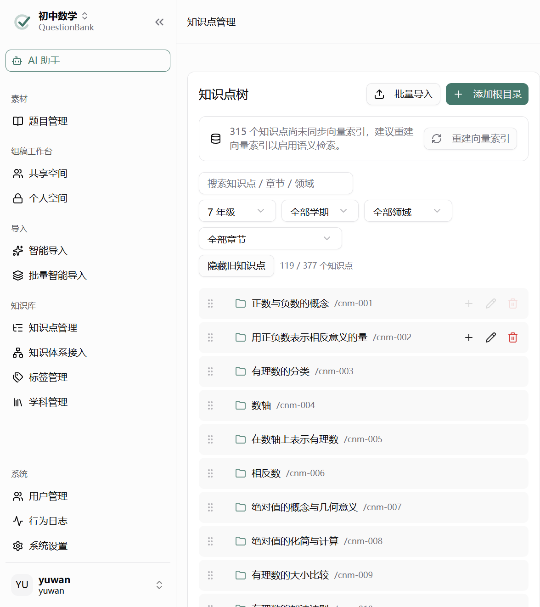
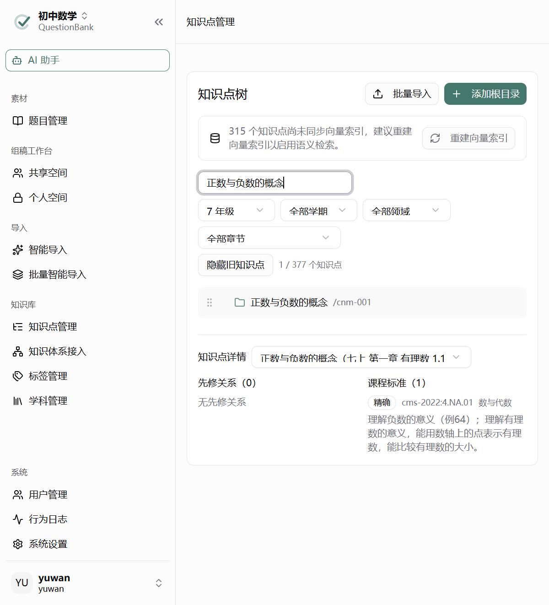
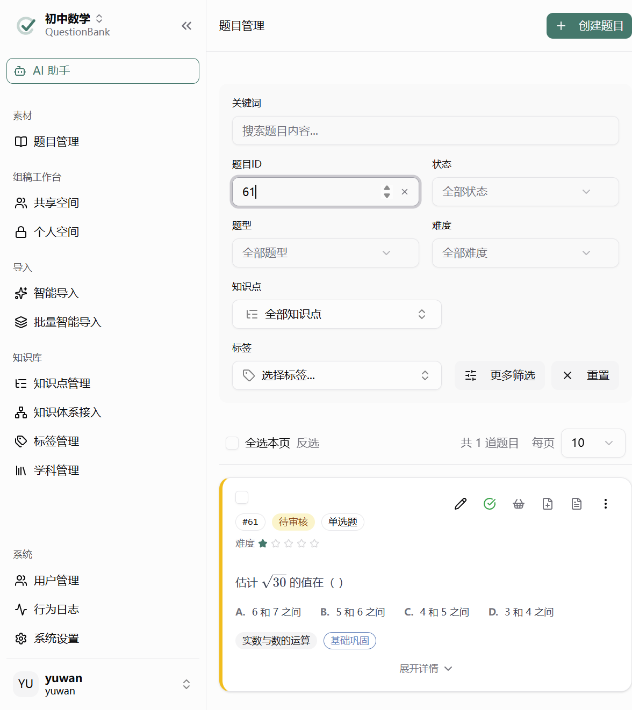
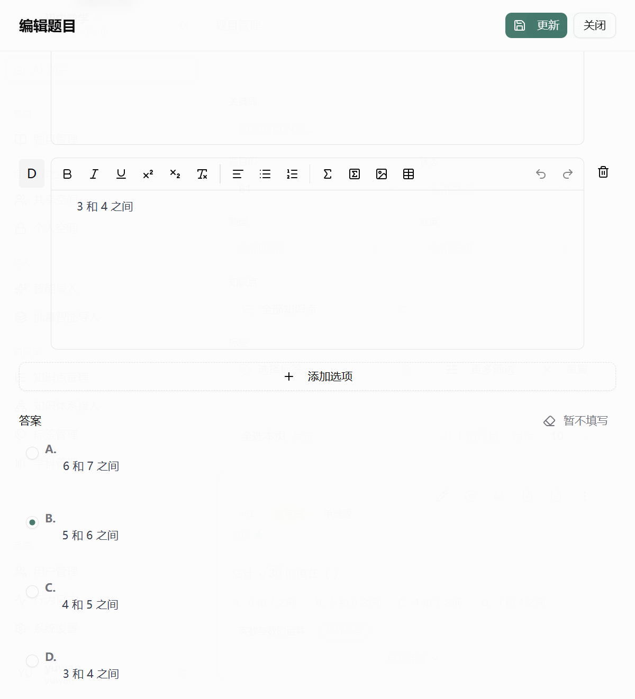
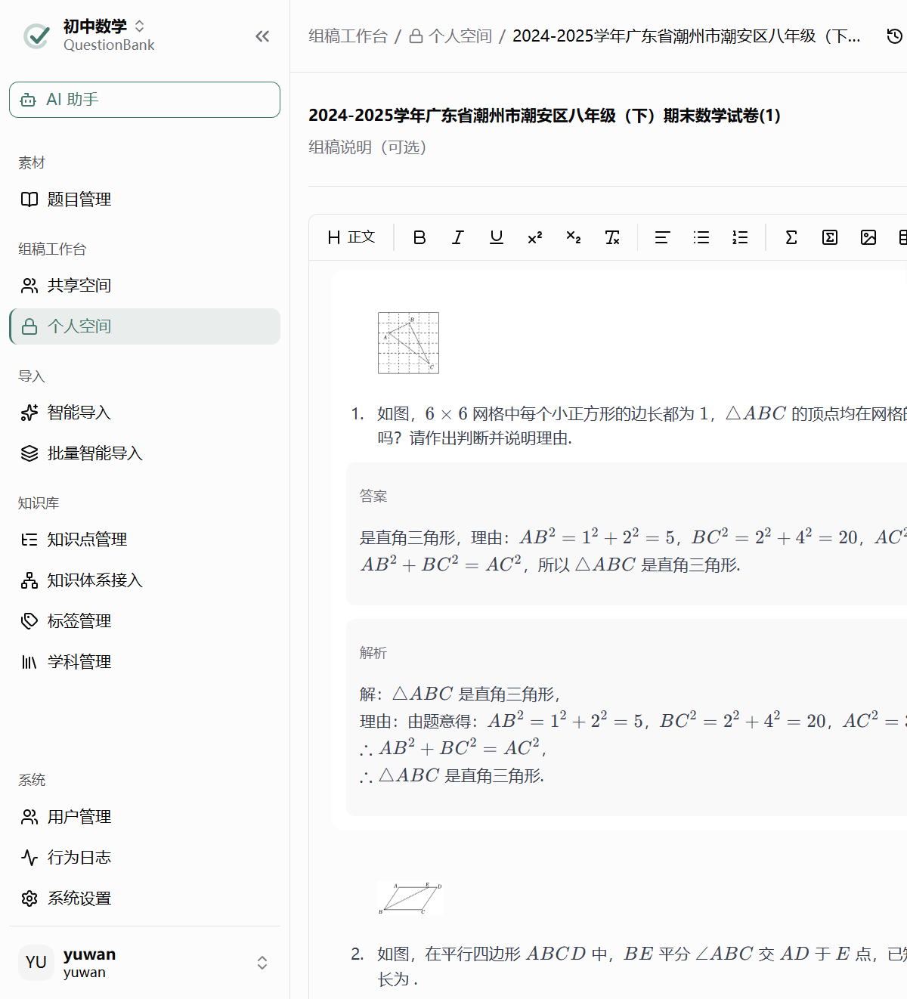
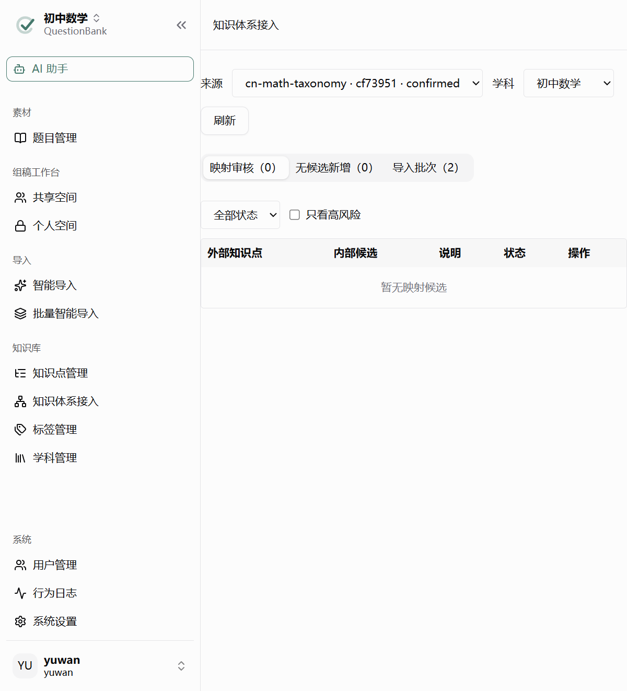
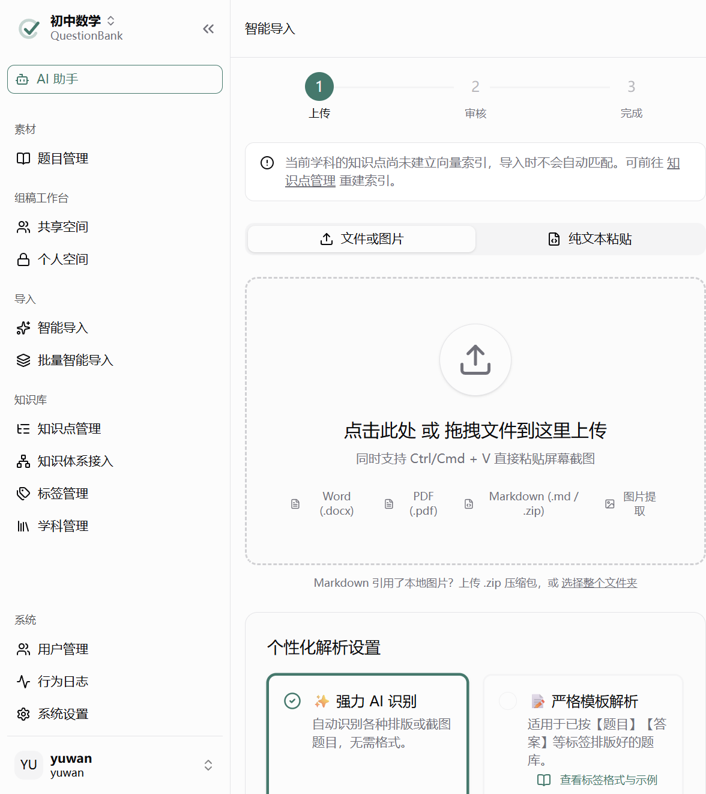

# 61 代码部署与浏览器验收报告

> 日期：2026-11-14
> 环境：Windows + Docker Desktop（WSL2），`http://localhost`
> 部署目录：`/home/yuwan/projects/workspace/question-bank`
> 开发仓库：`/home/yuwan/projects/workspace/question-bank-taipy`

---

## 1. 部署结果

| 项 | 值 |
|---|---|
| 后端镜像 | `question-bank-backend:20261114-taxonomy`（`18cebe221539`） |
| 前端镜像 | `question-bank-frontend:20261114-taxonomy`（`d2b6638630ec`） |
| 后端 | Up，`RestartCount=0` |
| Worker | Up |
| 前端 | Up |
| MySQL | 未重建 |
| ChromaDB | 未重建、未写入 |
| 数据库版本 | `a8b9c0d1e2f3` |

### 部署过程中处理的两个问题

1. **后端容器反复退出（exit 0）**
   - 原因：叠加 Dockerfile 显式设置 `ENTRYPOINT` 时，Docker 清空了从基础镜像继承的 `CMD`，容器无命令可执行。
   - 修复：补回 `CMD ["fastapi", "run", "app/main.py"]`，重建后端镜像。
2. **后端重启后前端 502**
   - 原因：前端 nginx 缓存了后端旧容器 IP。
   - 修复：`docker compose restart frontend`，重新解析 `backend` 主机名。

### 回滚快照

| 项 | 路径 / 值 |
|---|---|
| `.env` 备份 | `question-bank/.env.bak.20261114_1915` |
| `.env` 备份副本 | `/home/yuwan/backups/deploy/question-bank.env.20261114_1915` |
| Compose 快照 | `/home/yuwan/backups/deploy/question-bank.compose.20261114_1915.yml` |
| 旧后端镜像 | `question-bank-backend:20261102-3d7bd925`（`90abede36a86`） |
| 旧前端镜像 | `question-bank-frontend:20261102-3d7bd925`（`2de1292f7155`） |

回滚命令：

```bash
cd /home/yuwan/projects/workspace/question-bank
cp .env.bak.20261114_1915 .env
docker compose up -d --no-deps backend worker frontend
```

> 旧镜像兼容 a8b9 已在独立测试库验证通过。

---

## 2. 健康检查

| 检查 | 结果 |
|---|---|
| `http://localhost/` | 200 |
| `http://localhost/login` | 301（SPA 路由） |
| `http://localhost/api/v1/knowledge-points`（未登录） | 401（后端可达） |
| 后端日志 | uvicorn `Application startup complete`，无崩溃 |
| 前端 nginx | 正常代理 |
| 控制台错误 | 0 |
| 网络 4xx/5xx（组稿页 151 个请求） | 0 |

---

## 3. 浏览器验收（手动登录后）

### 3.1 知识点管理

| 验证项 | 结果 |
|---|---|
| 默认知识点数量 | **315 / 377**（只显示正式知识点） |
| “显示旧知识点（62）”开关 | 点击后变为“隐藏旧知识点”，数量 **377 / 377** |
| 年级筛选 | 7 年级 → **119 / 377** |
| 学期 / 领域 / 章节筛选 | 下拉选项正常，级联可用 |
| 搜索 | “正数与负数的概念” → **1 / 377** |
| 详情：先修关系 | “用正负数表示相反意义的量” → **先修关系（1）**，必需先修“正数与负数的概念” |
| 详情：课程标准 | **课程标准（1）**，`cms-2022:4.NA.01`，精确，数与代数，标准原文正常 |





### 3.2 题目管理

| 验证项 | 结果 |
|---|---|
| 题目总数 | **72**（74 道中含 2 道软删除，UI 自动排除） |
| 题目 ID 61 | 可按 ID 精确筛选 |
| 旧知识点关联 | 题目卡片显示 **“实数与数的运算”**（旧知识点名称正常） |
| 编辑弹窗 | “所属知识点”显示 **“实数与数的运算”**，可正常移除 |
| 题干 / 选项 / 答案 | 正常渲染（含图片与数学公式） |




### 3.3 组稿工作台

| 验证项 | 结果 |
|---|---|
| 数据库中稿件 | 2 份 |
| 活动稿件 | **1 份**（另一份 `deleted_at=2026-10-25`，为本次工作之前已软删除） |
| 打开编辑 | 正常加载标题、题干、答案、解析、图片与格式工具栏 |



### 3.4 知识体系接入

| 验证项 | 结果 |
|---|---|
| 来源 | `cn-math-taxonomy · cf73951 · confirmed` |
| 学科 | 初中数学 |
| 导入批次 | 2（一次 apply、一次幂等 validate） |
| 映射审核 / 无候选新增 | 0 / 0 |



### 3.5 智能导入

| 验证项 | 结果 |
|---|---|
| 页面加载 | 正常 |
| 向量索引提示 | “当前学科的知识点尚未建立向量索引，导入时不会自动匹配” |
| 上传 / 纯文本 / 解析设置 | 正常 |



---

## 4. 数据完整性

| 指标 | 结果 |
|---|---|
| Alembic | `a8b9c0d1e2f3` |
| 学科 | 初中数学 |
| 知识点总数 | 377 |
| 正式知识点 | 315 |
| 题目 | 74（2 道软删除，UI 显示 72） |
| 题目—知识点关联 | 38（旧关联完整保留） |
| 稿件 | 2（1 活动 + 1 早先软删除） |
| 活动日志 | 116（验收登录新增 2 条） |
| ChromaDB | 未写入 |

**本次浏览器验收未删除、未修改任何业务数据。**

---

## 5. 已知限制

| 项 | 说明 |
|---|---|
| ChromaDB 未重建 | 315 个新知识点尚未写入向量库；AI 知识点匹配当前不会返回新候选 |
| 旧向量防护 | 旧 62 条向量会按数据库现存 ID 过滤，不会作为正式候选 |
| 页面提示 | 知识点页与智能导入页均明确提示“尚未建立向量索引” |
| 旧知识点 | 保留在库中，`is_formal=false`，默认隐藏，可通过开关显示 |

---

## 6. 结论

- 新后端 / 前端 / Worker 已部署并稳定运行；
- 315 个正式知识点、四维筛选、先修与课标详情在浏览器中验证通过；
- 旧题 74 道与旧知识点关联名称正常显示；
- 组稿、知识体系接入、智能导入页面正常；
- 控制台与网络无错误；
- 仅剩 ChromaDB 重建（需单独授权）后，AI 知识点匹配才能使用新 315 集合。
