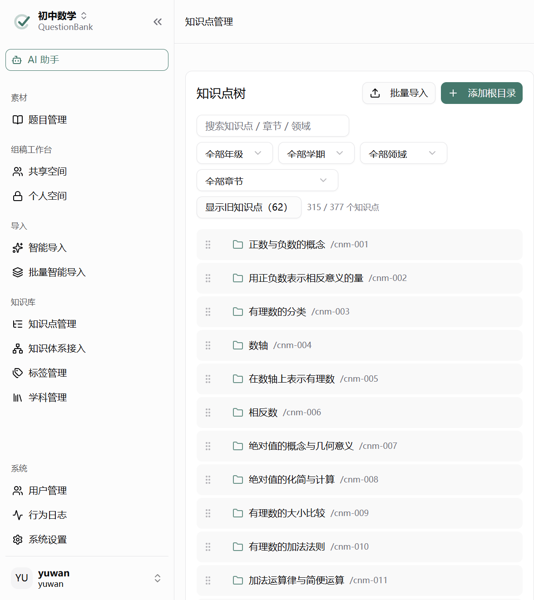
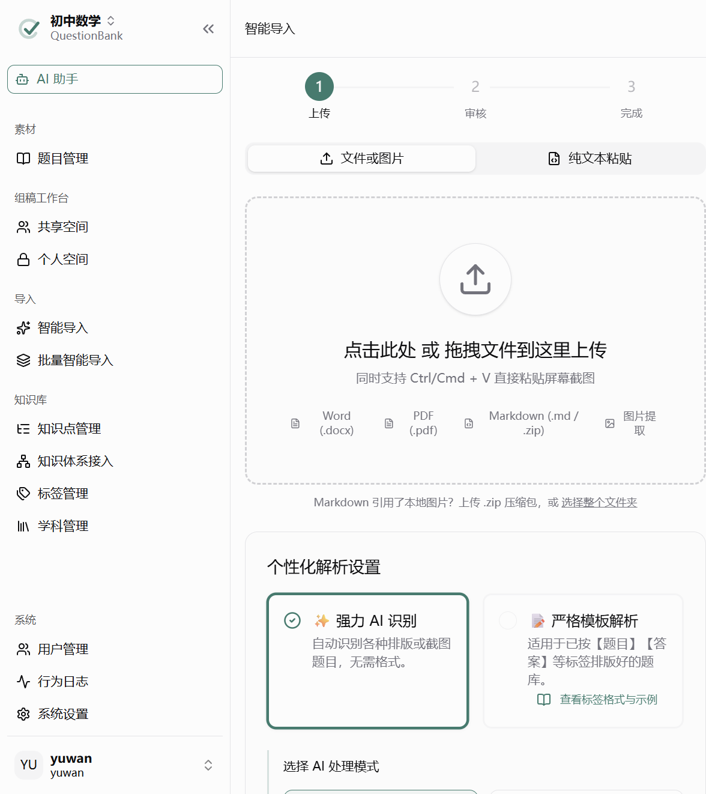

# 62 ChromaDB 重建结果报告

> 日期：2026-11-14
> 范围：仅 `subject_id=1`（初中数学）
> 状态：**PASS**

---

## 1. 重建前备份

| 项 | 值 |
|---|---|
| 备份文件 | `/home/yuwan/backups/chroma/knowledge_points_pre_reindex_20261114_220737.json` |
| 大小 | 864,102 bytes |
| SHA256 | `6ae1ec022338d8383362b2b2041e4f317e0f09de8075a74061ad3f19ac6ad404` |
| 向量条数 | 62 |
| 向量维度 | 1024 |
| ID 范围 | 1–62（全部为旧知识点） |
| 内容 | ids + embeddings + metadatas + documents |

恢复时可直接 `add(ids, embeddings, metadatas, documents)`，无需重新调用 Embedding API。

---

## 2. 代码修复

| 文件 | 修改 |
|---|---|
| `app/crud/crud_knowledge_point.py` | 重建只取正式知识点（join `knowledge_point_taxonomy`）；先删除该学科全部 377 个 ID 的向量（含旧 62），再写入 315；未传 `subject_id` 且未 `full=True` 时拒绝执行 |
| `app/api/v1/endpoints/knowledge_points.py` | `vector-status` / `embedding-status` 只统计正式知识点；`vector_count` 按学科统计；`reindex-vectors` 增加 `full` 参数 |
| `app/services/kp_retriever.py` | 检索结果过滤改为“属于正式知识点”，旧知识点即使有残留向量也不会成为候选 |
| `frontend/app/pages/knowledge-points/index.vue` | 重建按钮传入当前 `subject_id`，避免全量清空 |
| 测试 | 新增 `tests/test_reindex_formal_only.py`（3 项）；API 测试新增 `vector-status` 统计口径测试 |

---

## 3. 部署

| 项 | 值 |
|---|---|
| 后端镜像 | `question-bank-backend:20261114-chroma`（`919d2f880b65`） |
| 前端镜像 | `question-bank-frontend:20261114-chroma`（`4057d30fae98`） |
| `.env` 备份 | `question-bank/.env.bak.20261114_chroma`（SHA256 `12906d1a…`） |
| 后端 / Worker / 前端 | 均已重建并运行 |
| MySQL / ChromaDB 容器 | 未重建 |
| `/` | 200 |
| `/api/v1/knowledge-points`（未登录） | 401 |

---

## 4. 重建执行

```http
POST /api/v1/knowledge-points/reindex-vectors?subject_id=1
```

响应：

```json
{"status":"success","reindexed":315,"duration":13.12}
```

---

## 5. 验收结果

### 5.1 Chroma collection

| 检查 | 结果 |
|---|---|
| 向量总数 | **315** |
| ID 最小值 / 最大值 | 64 / 378 |
| ID < 63（旧知识点） | **0** |
| subject_id | 1 |
| 样本 document | `初中数学 > 正数与负数的概念` |

### 5.2 与数据库正式集合比对

| 检查 | 结果 |
|---|---|
| 数据库正式知识点 | 315 |
| Chroma 向量 | 315 |
| 集合完全一致 | **True** |
| 缺失 | 0 |
| 多余 | 0 |
| 旧 ID（≤62） | **0** |

### 5.3 状态接口

```json
vector-status:
{"db_count":315,"vector_count":315,"needs_reindex":false,"reason":"向量索引已是最新"}

embedding-status:
{"kp_total":315,"kp_vectorized":true}
```

### 5.4 检索验证

查询“有理数”返回：

```text
['66', '80', '68', '77', '140']
all_formal: True
```

全部为正式知识点 ID，无旧知识点。

### 5.5 UI 验证

| 页面 | 结果 |
|---|---|
| 知识点管理 | “尚未同步向量索引”提示消失；默认 315 / 377 |
| 智能导入 | “尚未建立向量索引”提示消失 |




---

## 6. Embedding 兼容性

| 项 | 值 |
|---|---|
| 模型 | `text-embedding-v4`（阿里云 DashScope） |
| 实测输出维度 | 1024 |
| 旧向量维度 | 1024 |
| 结论 | 兼容，重建成功 |

---

## 7. 回滚方案

### 7.1 恢复旧 62 条向量

使用备份文件：

```python
payload = json.load(open("/home/yuwan/backups/chroma/knowledge_points_pre_reindex_20261114_220737.json"))
client.delete_collection("knowledge_points")
col = client.create_collection("knowledge_points")
col.add(
    ids=payload["ids"],
    embeddings=payload["embeddings"],
    metadatas=payload["metadatas"],
    documents=payload["documents"],
)
```

恢复后需把代码回退到 `20261114-taxonomy`（或旧版本），否则正式过滤逻辑仍会忽略旧向量。

### 7.2 代码 / 镜像回滚

```bash
cd /home/yuwan/projects/workspace/question-bank
cp .env.bak.20261114_chroma .env
docker compose up -d --no-deps backend worker frontend
```

旧镜像 `20261114-taxonomy` 仍在本地。

---

## 8. 数据边界

| 项 | 状态 |
|---|---|
| MySQL 数据 | 未修改 |
| 旧 62 个知识点 | 保留，未删除 |
| 旧 74 道题及 38 条关联 | 保留 |
| 活动日志 | 未处理 |
| Chroma 写入范围 | 仅 `knowledge_points` collection、subject 1 |
| 其他学科向量 | 未触碰（当前仅一个学科） |

---

## 9. 结论

- Chroma 已从 62 条旧向量重建为 **315 条正式知识点向量**；
- 数据库正式集合与 Chroma 集合 **完全一致**；
- 旧知识点向量 **0 条残留**；
- AI 检索只返回正式知识点；
- 状态接口与 UI 均显示 315/315；
- 回滚备份已就绪。
